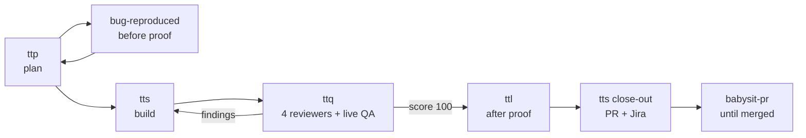
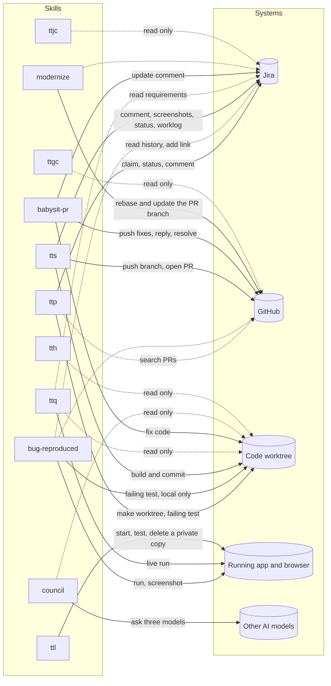

# tstack

The agent skills I use every day to take a Jira ticket from To Do to a merged
pull request, with before and after proof. They work in Claude Code, Codex and
Cursor. Some use [T3 Code](https://github.com/pingdotgg/t3code) features when
they are available and fall back to native tools when they are not.

The idea and the layout of this repo come from
[t3dotgg/tstack](https://github.com/t3dotgg/tstack). The skills are my own.

## Skills

| Skill | Say | What it does |
|---|---|---|
| `full-send` | "full send PROJ-123" | Does everything below in one go with nobody watching, and stays on the PR until it is merged. |
| `ttp` | "ttp" | Time to plan. Picks or takes a ticket, reproduces the bug, researches with many sub-agents, and writes a checked plan. Then explains in simple words what is wrong, why, and how it will be fixed. |
| `bug-reproduced` | (automatic) | Replays a bug step by step, saves the before screenshots and logs, writes a failing test and names the cause. |
| `tts` | "tts" | Time to ship. Builds the plan with parallel sub-agents in one worktree, loops with `ttq` until it passes, opens the PR and updates Jira. |
| `ttq` | "ttq" | Time to QA. Four code reviewers, a live run and a senior QA check of every acceptance criterion. Scores out of 100. |
| `ttl` | "ttl" | Time to live. A private running copy of the app per agent, for screenshots, API calls and logs. Aruva-specific. |
| `babysit-pr` | "babysit" | Watches a PR through CI and review, fixes real findings, resolves every comment, stays until merged. |
| `council` | "council" | Gets a review from Grok, Claude Opus and GPT at medium effort, and loops until they agree. |
| `modernize` | "modernize" | Rebases an old PR and decides if it should still exist. |
| `ttjc` | "ttjc" + Jira link | Time to Jira comments. Explains the ticket, what each person is asking, and what to do next. |
| `ttgc` | "ttgc" + PR link | Time to GitHub comments. Explains the PR, what each reviewer is asking, and what to do next. |
| `tth` | "tth" | Time to help. Says how each skill works and, mid-chat, where the work stands and what to type next. |
| `plain-talk` | "plain-talk" | Explains any ticket, bug or result as a short story in everyday words. |
| `unslop` | (automatic) | The writing style for every reply, plan, commit, PR and Jira comment. |
| `postwork` | (automatic) | Reviewer: checks finished work against its ticket. |
| `ticket-prework-review` | (automatic) | Reviewer: checks a ticket and plan before building starts. |

## How they fit together

The pipeline, in order. `full-send` runs the whole chain.



- `ttp` uses `bug-reproduced`, `ticket-prework-review` and `ttl`.
- `tts` uses `ttq`, `ttl` and `babysit-pr`.
- `ttq` uses `postwork` and `ttl`.
- Everything uses `unslop`.

## What each skill can touch

A solid arrow means the skill changes that system. A dotted arrow means it only reads.



| Skill | Jira | GitHub | Code | Running app | Never does |
|---|---|---|---|---|---|
| `ttp` | Assigns the ticket to you, moves it to In Progress, posts the plan comment | Reads PRs | Makes the worktree, commits one failing test locally | Through `bug-reproduced` and `ttl` | Push, or change product code |
| `bug-reproduced` | Reads tickets, links a repeat bug to the old one | Reads PRs and history | Commits a failing test locally | Runs it, takes before screenshots and logs | Push |
| `tts` | Comments, uploads screenshots, moves to Code Review, logs time | Pushes the branch and the proof, opens the PR | Builds and commits inside the worktree | Through `ttq` and `ttl` | Merge, force-push, touch production |
| `ttq` | Reads. Drafts bugs, files them only with your yes | Reads the diff | Reads only | Runs every scenario live | Edit code |
| `ttl` | Nothing | Nothing | Reads the worktree to build from | Starts and deletes its own private copy | Touch another agent's copy or the shared stack |
| `babysit-pr` | Posts the review-fix and merge updates | Pushes fixes, replies, resolves threads | Fixes what CI and reviewers found | Reruns the live steps a fix touches | Merge, unless you asked in clear words |
| `modernize` | Reads the ticket | Updates the PR's own branch after a rebase | Rebases | Reruns checks | Merge, close, widen the scope |
| `council` | Nothing | Nothing | Reads only | Nothing | Edit anything |
| `ttjc` | Reads only | Nothing | Nothing | Nothing | Post without your yes |
| `ttgc` | Reads the ticket summary | Reads only | Nothing | Nothing | Post, resolve or push without your yes |
| `tth` | Nothing | Nothing | Reads the task files | Nothing | Change anything |

Every skill stops and asks before these: a force-push or history rewrite, a database migration, anything on shared, staging or production systems, secrets, dependency upgrades, CI changes, and deleting tests.

## What the pipeline promises

- Requirements come only from words the BA wrote in Jira. Every decision is logged with its source.
- Nothing passes without a live run. UI changes are proven with UI screenshots.
- The PR and the Jira ticket both carry before and after screenshots, taken with the same steps.
- You get updates in simple words: a progress table, what was just fixed and why, and what is being fixed now. Every 10 minutes by day, every hour in the evening, none overnight.
- The chat is named after the ticket: `PROJ-123` for the pipeline, `JC PROJ-123` for Jira comments, `GC PROJ-123 #45` for GitHub comments.

## Install

```bash
npx skills@latest add talibilat/tstack -g
```

Or by hand:

```bash
git clone https://github.com/talibilat/tstack
cp -R tstack/skills/* ~/.claude/skills/   # Claude Code
cp -R tstack/skills/* ~/.codex/skills/    # Codex
```

## Setup

There is nothing to fill in before the first run. The skills ask for what they need, once:

- **Jira and repos.** On first run, `ttp` writes `skills/ttp/references/setup.md` from your Jira and git tools and asks for the rest. Add your BA's name there.
- **Jira API token.** Needed only to upload screenshots to tickets. The skill asks for it once and saves it in `~/.config/tstack/jira.env`, outside the repo.

## Requirements

- An Atlassian Jira connector in your agent.
- An authenticated [GitHub CLI](https://cli.github.com) (`gh`), and git.
- `python3` for the progress board, the PR status script and the Jira upload.
- `council` needs sub-agents on other providers' models. T3 Code does this with `delegate_task`.
- `ttl` needs the local Aruva setup in `skills/ttl/references/setup.md`.

`postwork` also reads Matt Pocock's `code-review` skill. That file is not in this repo. Copy it to `skills/postwork/references/matt-code-review.md`.

Optional reviewers, used when installed: `interrogate` and `blast-radius` (pstack), `ponytail-review`, `thermo-nuclear-code-quality-review`, `grilling`, `diagnosing-bugs`, `tdd`. A missing reviewer shows as NOT RUN.

## Make them yours

These are starting points. Edit them. Whatever you type after a skill name outranks the skill's own rules, so "ttp PROJ-123, plan only" or "updates every 30 minutes" just works.

## License

[MIT](LICENSE)
