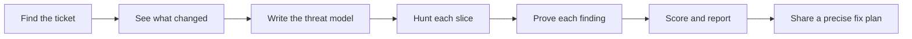

Never assume a requirement. Check Jira for the latest requirements before acting. If a requirement is unclear or cannot be verified, ask the user in plain language before proceeding with work that depends on it.

# Ticket post-work review

Check the finished work against its ticket. Its partner, `ticket-prework-review`, checks the ticket before the work starts. This one checks the code does what the ticket asked, safely, and touches nothing it shouldn't.



This skill only reports. It never edits project code or the ticket, and it writes no report files. Throwaway proof tests and scripts go in the scratchpad, a temp folder or a throwaway worktree, and you delete them when done.

## Mandatory standards and spec review

Read `references/matt-code-review.md` in full for every review. It contains Matt Pocock's complete code review skill, including its standards sources and code smell baseline. Apply both the Standards and Spec axes alongside the existing safety, bug and scope checks. Respect documented repo standards and treat smells as judgement calls. Cite the exact standard or requirement and evidence for each finding. Report Standards and Spec separately, with a count and worst finding for each. Do not merge or rerank the axes.

Identify and validate the comparison point and spec using Matt's process. If the user gives neither, first use the ticket and branch comparison below; ask only if those do not establish them. Include committed, staged, unstaged and relevant untracked changes in the requested review. State exactly what was reviewed. If no spec exists or a comparison cannot be established, disclose the limitation and do not claim a full pass.

Run the Standards and Spec reviews in parallel fresh-context subagents when available and authorized, following Matt's prompts and including the complete smell baseline. If delegation is unavailable or prohibited, perform both independent passes yourself and disclose the limitation. Do not require unrelated tracker setup when the ticket or spec is already available.

Apply a strict gate: any proven material standards violation, missing or partial requirement, scope violation, safety flaw, regression, or missing or weakened required test fails the review, regardless of score. Unverified requirements, unavailable required tests, missing specs or incomplete coverage prevent PASS; report PASS WITH MANUAL CHECKS only when the remaining checks can be completed manually and identify them. Never invent findings, treat a smell alone as a hard violation, or claim safety without evidence. Existing project or user instructions take precedence.

## How this review finds problems

A broad "find every problem in this diff" pass returns a long list of generic risks, many in code no attacker can reach. This review narrows the search instead:

1. A **threat model** of under 20 lines says who can attack the change, where they get in, and which rules must stay true.
2. The change splits into **thin slices**, one per trust boundary or risky operation, and each slice gets its own focused search.
3. A **verifier** proves each suspect by running it or tracing it end to end. Only proven problems count.

Spend little effort on setup (steps 1 to 4), most of it on the hunt, and about a quarter on proof. Keep the working context small. Read the slice you're hunting and its callers, not every file at once.

## Strict, not picky

The result decides whether work can merge, so people must trust it both ways. Missing a real problem makes it useless. Inventing problems gets it ignored.

| Be strict about | Example |
|---|---|
| Anything the ticket asks for that isn't fully built | The ticket asks for a warning to teachers, and no warning appears. |
| Anything on the don't-touch list that changed | The ticket says "don't edit the ID checker", and the ID checker changed. |
| Anything that could leak data, crash, corrupt data or lock people out | Changing the number in a report link opens someone else's report. |
| Required tests missing, or old tests weakened so they pass | A test that used to expect 3 results now expects "any number". |

| Never score or block on by itself | Example |
|---|---|
| Personal style, naming, formatting, code layout (documented standards are checked separately) | "I'd call this variable `count`." |
| Another approach that would also work | "A loop would read better than this filter." |
| Problems that were there before this change | An old bug in a file the change only touched lightly |

Put anything worth saying from the second table under "Optional improvements" (at most 3) or "There before this change". The hunt assumes bugs exist so you search hard. The report states only what you proved, so a clean change gets a clean report and an empty findings table is a correct result.

## Step 1. Find the ticket

| The user gives | What to do | Example |
|---|---|---|
| A file path | Read it. | `.scratch/03-question-skill-relevance-check.md` |
| A number | Look in `.scratch/` for a file starting with that number, padded to two digits. | "ticket 3" finds `03-*.md` |
| A tracker ID | Search ticket headers for it. | `ARPP-3732` |
| Pasted text | Use it as it is. | A ticket pasted into the chat |

If several match, list them and ask. If none match, say where you looked and ask. Read the whole ticket, especially what must work, the don't-touch list, what's left out, the unusual cases, the tests and any threat model section.

## Step 2. Name the chat

Rename this chat to `tXX-pw-vXX`.

| Part | Meaning | Example |
|---|---|---|
| `tXX` | The ticket number, two digits. Use the tracker ID if the ticket has no number. | `t03`, or `tARPP-3732` |
| `pw` | This is a post-work review. | `pw` |
| `vXX` | Which post-work review of this ticket this is, two digits. | `v01` for the first, `v02` after a round of fixes |

To find the version, look at existing chat names starting with `tXX-pw-` and use the next number. If you can't see other chats, use `v01` and tell the user so they can correct it. Use the app's rename tool (for example a set-session-title tool, or a rename-chat skill). If there isn't one, give the user the name to set by hand.

## Step 3. See what changed

| Situation | What to do | Example |
|---|---|---|
| The user named files or gave a diff | Review exactly that. | "Review `skill-relevance.service.ts`" |
| A git branch | Find the main branch (`git symbolic-ref refs/remotes/origin/HEAD`, else `main`, else `master`). Compare with `git diff <main>...HEAD`, add `git diff HEAD` for unsaved work and new files from `git status --porcelain`. | Branch `fix/skill-rules` against `dev` |
| No git, or no changes found | Say so and ask which files to review. | |

Skip generated files, such as build output, `__pycache__`, editor files and lock-file churn the ticket didn't ask for. They don't count against scope.

Then read the project's past fixes in the changed files. Bug classes the project has already had are the likeliest to come back.

```bash
git log --oneline -i -E --grep='fix|bug|secur|vuln|auth|bypass|leak|inject|permission' -- <changed files>
```

Open the 3 to 5 most relevant fix commits and note the bug class each one fixed. Also note findings from earlier `tXX-pw-` reviews of this ticket if the user shares them.

## Step 4. Write the threat model

Keep it under 20 lines. It's a working note you extend during the hunt, not a document.

| Part | What to write | Example |
|---|---|---|
| The change | One sentence on what it does. | "Adds a route that returns a quiz's results." |
| Past bugs here | The bug classes from step 3's fix commits. | "Two past fixes added missing school checks to report routes." |
| Entry points | Where outside input reaches the changed code: routes, queue consumers, CLI commands, scheduled jobs, webhooks, file uploads, model tool calls. | "`GET /quiz/:id/results`" |
| Trust boundaries | Where data crosses from less trusted to more trusted: browser to server, user or document text into a prompt, service to service, one school or tenant to another. | "Quiz id from the URL into a database read." |
| Risky operations | Queries, shell commands, file paths, deserialising, HTML templates, login and permission checks, parsing outside input, prompts built from outside text, deletes, payments. | "A database read keyed on the URL id." |
| Attackers | Only those who can reach the change: remote with no login, logged-in user with the lowest role, user from another school or tenant, author of a document or other text a model reads. Say what each can and can't do. | "A logged-in student. Can send any request to the public API. Can't reach the database or internal services." |
| Rules that must stay true | 3 to 8 lines of the form "only X can do Y" or "every Z passes check W". Take them from the ticket's must-work and don't-touch lists, the past fixes and the code's own guards. | "Only the teacher who owns a quiz can read its results." |
| Slices | 1 to 4 thin slices. Each is one trust boundary or risky operation, from its entry points to where the data ends up. | "Slice 1: the results route, from the URL id to the database read." |

If the ticket already has a threat model or rules section (`ticket-prework-review` adds one), start from it and extend it. If the change crosses no trust boundary, say so in one line. The hunt then covers bugs only, as one slice.

When a slice turns up a new entry point, attacker path or rule, add it to the model.

## Step 5. Check it was built and stayed in bounds

These two areas are bookkeeping. Every row points to evidence: a file and line, a test result, or a quoted ticket line.

| Area | What to check | Ratings | Example |
|---|---|---|---|
| A. Did it do what the ticket asked? | One row per planned change and per "must work" item. Check required tests were added and protected tests weren't edited. | Done, Partial, Missing, Can't verify | "Rule 4, never leave a question with no skills: Done, test at line 210." |
| D. Did it stay in bounds? | Every changed file is Expected or Unexpected. Each don't-touch item: changed or not. Anything marked "left out" done anyway. Formatting-only edits count as unexpected. | Expected, Unexpected | "Unexpected: the prompt file was reformatted." |

Read changed files in full where needed. A change can look right alone and be wrong in context. Run the tests the ticket names if you can. If you can't, say "not run".

"Can't verify" means it needs something you can't do here, such as a live model run. Say what's needed. No evidence either way is Can't verify, not Done.

## Step 6. Hunt each slice

This covers area B (is it safe?) and area C (did it add bugs?). Hunt one slice at a time, holding only the threat model, the slice's files and their direct callers.

Use these moves on every slice. Each one changes where you look. None of them lowers the proof bar in step 7.

| Move | Frame it as | Why it finds more |
|---|---|---|
| Play the attacker | "I've been hired to break this change, and I get paid only for attacks that work." | An auditor lists everything. An attacker looks for what pays off and follows it to the end. |
| Assume mistakes | "The developer made at least two mistakes in this slice. Find them." | Stops you explaining odd code away as intentional. Example: `let decoded = true` reads as a choice until you assume it's a bug. |
| Ask how to break it | "How would I break this?" in place of "Is this safe?" | "Is this safe?" has an easy answer, yes. "How would I break this?" makes you produce attacks. |
| List, then break | First list every assumption the slice's code makes about its inputs, its caller, the environment and the order of events. Then take each assumption alone and ask whether an attacker from the threat model can make it false. | Listing and judging in separate passes catches what a single pass skips. |
| Compare with the standard | For login, sessions, tokens, crypto, HTML cleaning, SQL and file paths, ask how this code differs from the standard safe way. | These have one right way and many wrong ones. Example: a JWT check that trusts the algorithm named in the token's own header. |
| Write the attack | For each suspect, write the exact request, input or sequence of events that breaks it. | If you can't write the attack, the suspect is probably false, and that's useful to know. |
| Ask what else | After the first pass, run up to two more: "Set aside [classes already found]. What subtler problems are left?" Stop when a pass adds nothing. | The first findings are the obvious ones. The subtle ones only come when you push past them. |
| Stay in the attacker's limits | Drop any attack that needs powers the threat model rules out, such as database access. | Removes problems nobody could actually cause. |

For area B, check each rule from the threat model against each attacker who can reach the slice. Also check the usual weak spots this change adds: outside text reaching queries, commands, file paths or web pages; weaker login or permission checks; secrets or personal data in code or logs; unsafe file reading; no size limits; risky new packages; prompt text a document could override.

For area C, the attacker is a normal user on a bad day. Check each unusual case in the ticket, then empty, single, largest and broken inputs, wrong conditions, off by one, errors swallowed silently, two saves overwriting each other, and old callers broken.

**Large changes.** When the change has two or more slices, or more than about 300 changed lines, and you can start subagents, give each slice its own subagent so each search runs in a small, fresh context. Its prompt holds only the threat model, the slice (files, entry points, where the data ends up, rules to check), the moves table above, and this request: "Return each suspect with the attack that triggers it, the file and line, and the call chain from attacker input to the harm." Keep each prompt under a page. Run steps 5 and 7 yourself.

## Step 7. Prove each finding

A suspect is not a finding. Every scored finding needs an exact place (file and line, or the ticket line it fails) and proof from this table.

| Proof | Result | Example |
|---|---|---|
| You ran it. A failing test, a local run or a request shows the harm. | Proven. Score it. | "A test that calls the results route as student B returns student A's marks." |
| You traced it. The full chain from attacker input to the harm, every guard on the way named and shown not to stop it. | Proven if the chain has no gaps. Score it. | "`id` from the URL, to `getResults(id)`, to the query. No owner check on the way." |
| A partial trace, or it needs something you can't run here, such as a live model or production data. | Can't verify. Don't score it. Say what would settle it. | "Needs a real model run to see if the document text overrides the prompt." |
| You couldn't build the attack. | Drop it. List it under optional improvements only if a person should look. | |

Prefer running over tracing. Write proof tests outside the repo or in a throwaway worktree, quote their output under Evidence, and delete them after.

Check each Critical or High finding a second time. If you can start subagents, give one the finding and the code and ask it to prove the finding wrong. Keep the finding only if that attempt fails.

| Counts as a finding | Doesn't count |
|---|---|
| "If the retry fails, the question is saved through the backup route, which skips the new check. Example: a random-sampling question keeps its 'sensation' skill and the teacher isn't told." | "This might not scale." |
| "The new page loads every user's report. Example: user A sees user B's marks." | "Consider adding validation." |

Rate by realistic harm in this product, not the worst case imaginable. Apply the rules the same way every time, so two reviews of the same code give the same result.

## Step 8. Score out of 100

| Area | Points | How to score | Example |
|---|---|---|---|
| Did what was asked | 35 | 35 × (Done + half of Partial) ÷ rows that aren't Can't verify. All rows Can't verify gives 0, with a note. | 6 done, 1 partial, 8 rows: 35 × 6.5 ÷ 8 = 28 |
| Safe | 30 | Start at 30. Minus 30 per Critical, 15 per High, 6 per Medium, 2 per Low. Never below 0. | 1 Medium: 30 − 6 = 24 |
| No new bugs | 20 | Start at 20. Minus 8 per High, 4 per Medium, 1 per Low. Never below 0. | 1 Medium: 20 − 4 = 16 |
| Stayed in bounds | 15 | Start at 15. Minus 10 per don't-touch change, 5 per left-out item done, 3 per other unexpected change. Never below 0. | Nothing unexpected: 15 |

Only proven findings take points off. Round to the nearest whole number, halves up.

| Limit on the total | Why | Example |
|---|---|---|
| A Critical safety problem or a don't-touch change caps it at 59 | One serious problem can't hide behind a good average. | 92 points with one don't-touch change scores 59. |
| A Missing "must work" item caps it at 79 | Unfinished work can't score as ready. | 85 points with one Missing item scores 79. |

| Total | Verdict |
|---|---|
| 90 to 100 | Ready to merge |
| 80 to 89 | Merge after small fixes |
| 60 to 79 | Needs fixes |
| 0 to 59 | Not ready |

### Pass or fail

The gate is separate from the score, so one serious problem can't be averaged away.

| Gate | When | Example |
|---|---|---|
| FAIL | Any Critical or High safety problem, any High bug, any don't-touch change, any "must work" item Missing or Partial, a required test missing, an old test weakened, or a score below 80. | Score 88, but one rule is Partial: FAIL. |
| PASS WITH MANUAL CHECKS | Nothing fails, but some rows are Can't verify. List exactly what a person must check. | "Someone must run the dev syllabus and confirm the 3 bad links are flagged." |
| PASS | Everything else. | |

Any proven material Medium or Low finding also fails the gate. The score never overrides the strict gate above.

## Step 9. Write the report

Read and apply `~/.agents/skills/unslop/SKILL.md` before writing the report. Read `references/report.md` now. Follow its writing rules and layout, adding separate Standards and Spec sections as required above. Where its gate examples conflict with the strict gate, use the strict gate. The report is always in chat, never in a file.

## Step 10. Share a precise fix plan

End the report with a numbered plan for each proven finding, ordered by severity and dependencies. For each step, name the finding, exact files and functions when known, the change needed, and the test or other check that will prove the fix works. State any dependencies, uncertainty or manual checks without guessing. Keep the plan within the ticket's scope and distinguish confirmed fixes from choices that need investigation. If there are no findings, say no fixes are needed and list any remaining checks. Use Unslop and plain language throughout. Do not ask to update the ticket or make changes unless the user explicitly requests them.
