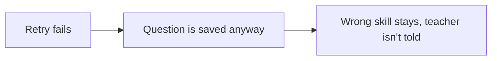

# Post-work report

Read and apply `~/.agents/skills/unslop/SKILL.md`. Write precisely for someone who does not write code. The top half must make sense without opening any code.

## Writing rules

| Rule | Too technical | Plain, with an example |
|---|---|---|
| Short sentences in everyday words | "The fallback persist skips the relevance gate." | "If the retry fails, the question is saved without the new check. Example: a random-sampling question keeps its 'sensation' skill, and the teacher isn't told." |
| An example in every row | "Edge case missed." | "Example: a quiz where every question correctly shares one skill still gets a warning." |
| Product words, not code words | "The payload is persisted." | "The questions are saved." |
| Code details go at the bottom | "`processor.ts:2517` skips the judge." | Top: "One save route skips the check." Bottom, under Evidence for developers: `processor.ts:2517`. |
| Label made-up examples | Presenting an invented case as real | "Example (made up): user A opens user B's report." |

Common swaps:

| Instead of | Say |
|---|---|
| acceptance criteria | what must work |
| allowlist | the approved choices |
| payload | the questions and answers |
| persist | save |
| fail-open | carry on if the check is down |
| race condition | two saves overwrite each other |
| regression | something that used to work breaks |
| threat model | who could misuse this |
| invariant | a rule that must stay true |
| attack surface | the ways in |

## Pictures

Draw diagrams with Mermaid so they show as pictures. Use 3 to 6 boxes with everyday labels. Show what happens in the product, not how the code is laid out. If the chat can't show Mermaid, use plain text arrows.

Every report has a picture of the main problem, or of the right behaviour if nothing is wrong. Example:

Add one more picture for each blocking bug that two sentences can't explain.

## Report layout

| Part | What goes in it | Example |
|---|---|---|
| 1. Decision | The score as `NN/100` first, then the gate, the verdict, and one plain reason. The score is always out of 100. Do not score out of 10, out of 5, or as a percent on its own. Explain if the gate and the score seem to disagree. | "83/100. FAIL. Good work, but one save route skips the check." |
| 2. Reviewed | One line on what you compared, whether tests ran, and how many slices you hunted. | "The ticket branch against dev, 6 files, 2 slices. Tests run, all passing." |
| 3. Problems table | Columns: **# \| Problem \| Example \| Fix \| Proof**. Start each Problem with the rating and "Blocks merge" or "Doesn't block". Proof is "Ran it" or "Traced it". Most important first. | See the example table. |
| 4. Main picture | The main problem or the right behaviour. | The picture above |
| 5. Who could misuse this | The threat model in plain words. Columns: **Who \| How they get in \| Rule that must stay true \| Result**. Result is Held, Broken (point to a problem row) or Can't verify. One line if the change crosses no trust boundary. | "A logged-in student \| Changes the quiz number in the link \| Only the quiz's teacher sees results \| Held, test at line 88" |
| 6. What must work | Columns: **What must work \| Result \| Evidence**. Every planned change and "must work" item. Point to a problem row instead of repeating it. | "Never leave a question with no skills \| Done \| test at line 210" |
| 7. Score | The four areas, a bar for each, the sum and any limit applied. | See the example score table. |
| 8. Other checks | Every changed file and don't-touch item, flagging anything unexpected. Say if no safety or bug problems turned up after the hunt. What a person still has to check. | "All 6 files expected. The ID checker is untouched." |
| 9. Optional and older problems | At most 3 optional improvements, suspects you couldn't prove that a person should look at, and problems that were there before. None of them changes the score. Leave out if empty. | |
| 10. Evidence for developers | Numbered files, lines, ticket lines, the comparison, the past fix commits used, the attack or proof test for each finding, and test output. | "1. `processor.ts:2517`, backup save route. Proof test output: ..." |
| 11. Fix plan | End with the numbered plan from step 10 in the skill. Link each action to a proven finding and name the change, location and verification. If nothing needs fixing, say so and list remaining checks. | "1. Fix finding 1 in the results route. Check ownership before returning results. Test that a different user receives 403." |

Example problems table:

| # | Problem | Example | Fix | Proof |
|---|---|---|---|---|
| 1 | High, blocks merge. Someone can read another person's report. | Changing the number in the report link opens someone else's report. | Check the report belongs to the person opening it. | Ran it |
| 2 | Medium, doesn't block. Two batches finishing together overwrite each other's results. | A run with 15 quizzes keeps results for only 14. | Save all results once, after every batch finishes. | Traced it |

Example score table. Each bar has 10 blocks, filled in proportion to that area's score:

| Area | Score | Bar | Working |
|---|---|---|---|
| Did what was asked | 28/35 | ████████░░ | 35 × 6.5 ÷ 8 |
| Safe | 24/30 | ████████░░ | 30 − 6, one Medium |
| No new bugs | 16/20 | ████████░░ | 20 − 4, one Medium |
| Stayed in bounds | 15/15 | ██████████ | nothing unexpected |
| **Total** | **83/100** | | No limit applied. 28+24+16+15 = 83 |

## Last check

Before sending, read only the top half. Could a project manager explain each problem, its example and its fix? If not, rewrite that row.
