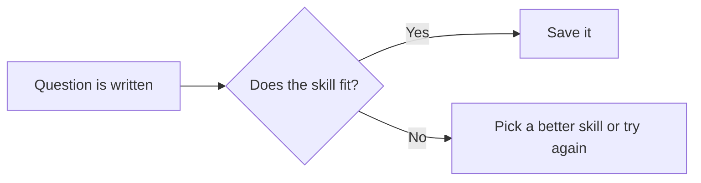
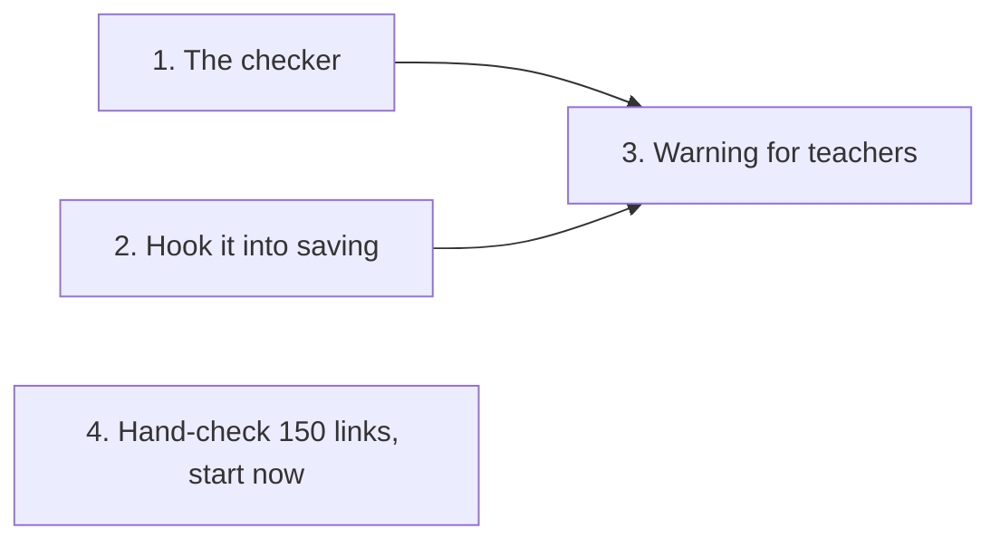

# Pre-work report

Write for someone who doesn't write code. The top half must make sense without opening any code.

## Writing rules

| Rule | Too technical | Plain, with an example |
|---|---|---|
| Short sentences in everyday words | "AC 1 conflicts with the fail-open path." | "Rule 1 says every question gets a result. But if the check breaks, the run carries on with no result. Example: the check times out, and rule 1 looks failed even though nothing went wrong." |
| An example in every row | "Edge cases incomplete." | "Example: a quiz where no skill fits any question. The ticket doesn't say what happens." |
| Product words, not code words | "The payload persists via the fallback." | "The questions are saved through the backup route." |
| Code details go at the bottom | "`processor.ts:2517` skips the judge." | Top: "One save route skips the check." Bottom, under Evidence for developers: `processor.ts:2517`. |
| Label made-up examples | Presenting an invented case as real | "Example (made up): a memory question linked to a vision skill." |

Common swaps:

| Instead of | Say |
|---|---|
| acceptance criteria | what must work |
| allowlist | the approved choices |
| payload | the questions and answers |
| persist | save |
| fail-open | carry on if the check is down |
| race condition | two saves overwrite each other |
| regression | something that used to work breaks |
| threat model | who could misuse this |
| invariant | a rule that must stay true |
| attack surface | the ways in |

## Pictures

Draw diagrams with Mermaid so they show as pictures. Use 3 to 6 boxes with everyday labels. Show what happens in the product, not how the code is laid out. If the chat can't show Mermaid, use plain text arrows.

Every report has two pictures:

1. **The main problem or fix.** Example:

2. **How the work splits.** Example:

## Report layout

| Part | What goes in it | Example |
|---|---|---|
| 1. Decision | The score as `NN/100`, the verdict, and one reason. | "68/100. Needs work. One save route skips the new check." |
| 2. Score | The seven checks, points for each, any points taken off, any limit, and the total as `NN/100`. | See the example score table. |
| 3. Changes table | The changes you suggest. Columns below. | See the example table. |
| 4. Main picture | The problem or the fix. | The first picture above |
| 5. Seven checks | One row per check: Present, Partial or Missing, plus the points. Point to a change row instead of repeating it. | "What will change: Partial, 8/15, see row 1." |
| 6. Who could misuse this | Whether the ticket crosses a trust boundary. If it does, the threat model as it stands or as proposed. Columns: **Who \| How they get in \| Rule that must stay true \| Attack to test**. If it doesn't, one line saying so. | "A logged-in student \| Changes the quiz number in the link \| Only the quiz's teacher sees results \| Student B asks for student A's results and is refused" |
| 7. Who does what | The work pieces, what "done" means for each, what waits for what, and the split picture. | "Piece 4 needs no code and can start today." |
| 8. Evidence for developers | Numbered files, lines, tests and past fix commits behind each row. | "1. `processor.ts:2517`, second save route." |

Example score table. Each bar has 10 blocks, filled in proportion to that check's points:

| Check | Score | Bar |
|---|---|---|
| The problem | 15/15 | ██████████ |
| What must work | 10/20 | █████░░░░░ |
| How to see it today | 15/15 | ██████████ |
| What will change | 8/15 | █████░░░░░ |
| What's left out | 10/10 | ██████████ |
| What may and may not be touched | 10/10 | ██████████ |
| Unusual cases, misuse and tests | 0/15 | ░░░░░░░░░░ |
| Taken off | 0 | No scope problems found |
| **Total** | **68/100** | 15+10+15+8+10+10+0 = 68. The 79 limit for a Missing check applies, but 68 is already lower. |

Changes table columns: **# | Section | Add, Change or Remove | Example | Now says | Will say | Why it matters**.

| # | Section | Add, Change or Remove | Example | Now says | Will say | Why it matters |
|---|---|---|---|---|---|---|
| 1 | Unusual cases | Add | A quiz where no skill fits any question | (nothing) | "If no skill fits, try once more, then flag the question for the teacher." | Without it, nobody tests this and the bug slips through. |
| 2 | What must work | Change | Two people would judge "too early" differently | "Users aren't logged out too early" | "Users stay logged in for 8 hours of inactivity" | Nobody can say whether the old wording passed. |
| 3 | Threat model | Add | A student changes the quiz number in the results link | (nothing) | "Only the teacher who owns a quiz can read its results. Test: student B asks for student A's results and is refused." | The builder can't protect a rule nobody wrote down, and the post-work review can't test it. |

## Last check

Before sending, read only the top half. Could a project manager explain each problem, its example and its fix? If not, rewrite that row.
